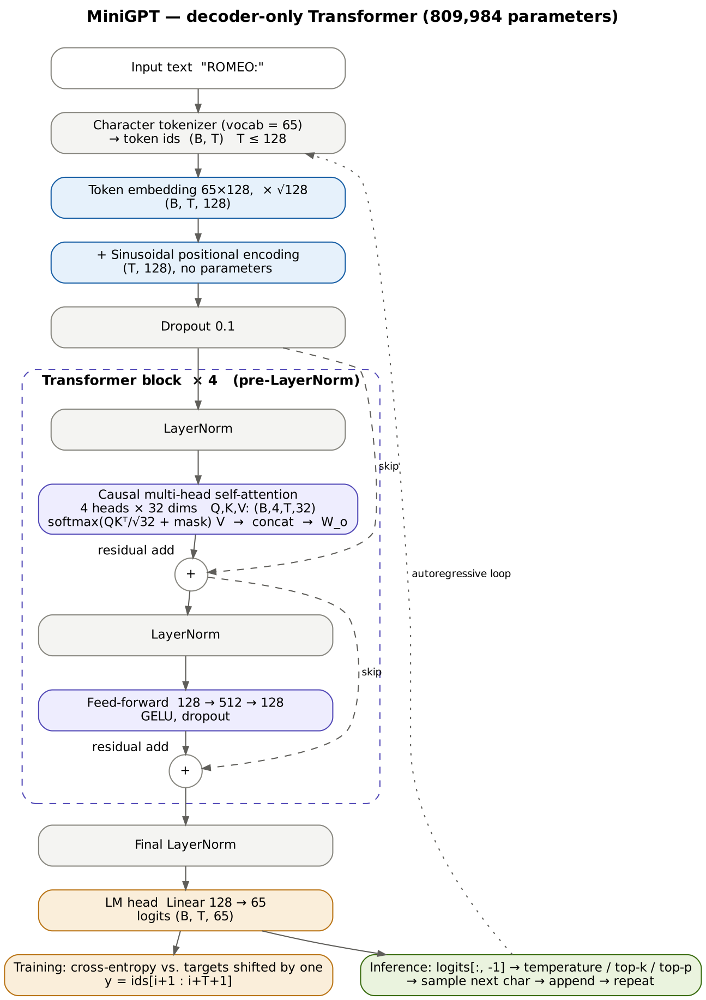

# MiniGPT: a GPT-style language model built from scratch

A small decoder-only Transformer, trained from scratch at the character level on **Tiny Shakespeare**.
Every architectural piece is implemented in this repository with plain PyTorch tensors and layers:
tokenizer, scaled dot-product attention, causal mask, multi-head split/merge, sinusoidal positions,
pre-LN Transformer block, LM head, next-token loss, training loop and sampling.
No pretrained checkpoint and no `transformers` model class are used anywhere.

```
raw text ─► char tokenizer ─► (B,T) ids ─► token emb·√C + sinusoidal PE ─► N × [LN ─► causal MHA ─► +res ─► LN ─► GELU FFN ─► +res]
         ─► final LN ─► LM head (B,T,V) ─► cross-entropy vs. inputs shifted by one ─► autoregressive sampling
```


## Submission links

| | |
|---|---|
| Live API (Render) | `https://<your-service>.onrender.com/`  (interactive docs at `/docs`) |
| Technical report (Medium) | `https://medium.com/@<you>/<article-slug>` |
| Demo video | `<link>` |
| Colab run with all outputs | [`notebooks/MiniGPT_Colab_executed.ipynb`](notebooks/MiniGPT_Colab_executed.ipynb) |



## Final submission checklist → where the evidence is

| Checklist item | Evidence in this repository |
|---|---|
| Repository link/access is correct | this repo (public, or instructor added as collaborator) |
| README setup commands work | [Setup](#setup); all run end-to-end in `notebooks/MiniGPT_Colab_executed.ipynb` |
| Hand-calculated attention | [`docs/hand_calculation/`](docs/hand_calculation/) (scan + check against code) |
| Causal mask is shown | `outputs/figures/fig2_causal_mask_3tok.png`, `fig2_causal_mask_12.png`; `tests/test_mask.py` |
| Multi-head shape trace | `outputs/logs/attention_numeric_and_shape_trace.txt` (`python -m experiments.shape_trace`) |
| Positional encoding evidence | `outputs/figures/fig4_positional_encoding.png`; `src/positional_encoding.py`; position ablation |
| Model architecture diagram | [`docs/architecture.png`](docs/architecture.png) (source: `docs/architecture.dot`) |
| Training/validation curves | `outputs/figures/tiny_gpt_loss.png`, `outputs/logs/tiny_gpt.csv`, `outputs/logs/tiny_gpt_stdout.txt` |
| At least five generation samples | `outputs/samples/evaluation.md` (5 fixed prompts + decoding comparison), `outputs/samples/tiny_gpt.txt`, `outputs/logs/generate_cli.txt` |
| Three required ablations | `outputs/ablation/ablation_results.md` + `ablation_{depth,heads,context}.png` (+ optional position) |
| Final parameter count and training configuration | [Baseline configuration](#baseline-configuration), `configs/tiny_gpt.yaml`, `outputs/logs/tiny_gpt_summary.json` |
| CLI/API inference works | `outputs/logs/generate_cli.txt`, `outputs/logs/api_demo_colab.txt`, `tests/test_api.py`, live Render URL |
| Technical report submitted as Medium article | link above (draft: [`docs/technical_report.md`](docs/technical_report.md)) |
| No secrets or unnecessary large artifacts | `.gitignore`; dataset is downloaded by code; only the 3 MB baseline checkpoint is committed |
| All sources are cited | [References](#references) |

## Repository map

| Path | What lives there |
|---|---|
| `src/tokenizer.py` | deterministic character tokenizer (vocab, special-token policy, save/load) |
| `src/dataset.py` | dataset download, 90/10 contiguous split, shifted `(x, y)` next-token windows |
| `src/attention.py` | `scaled_dot_product_attention`, `causal_mask`, single-head `SelfAttention`, `MultiHeadAttention` (explicit `split_heads` / `merge_heads`, shape tracing) |
| `src/positional_encoding.py` | sinusoidal encoding (default) + learned encoding (ablation) |
| `src/transformer_block.py` | GELU feed-forward + pre-LN block with residuals |
| `src/gpt.py` | **core model** `MiniGPT` + `GPTConfig` + `generate()` (temperature, greedy, top-k, top-p) |
| `src/train.py` | training loop (AdamW, warm-up + cosine LR, grad clipping, eval, checkpointing, logging, overfit gate) |
| `src/generate.py` | command-line inference |
| `src/utils.py` | config/overrides, seeding, checkpoint save/load (+ download from `CHECKPOINT_URL`) |
| `api/app.py` | FastAPI service (`/generate`, `/info`, `/health`, minimal web UI at `/`) |
| `configs/tiny_gpt.yaml` | baseline configuration |
| `tests/` | unit tests: attention, mask/causality, shapes, overfit + checkpoint reload, API |
| `experiments/` | evidence and studies (see below) |
| `notebooks/MiniGPT_Colab.ipynb` | end-to-end Colab runner (GPU), clean |
| `notebooks/MiniGPT_Colab_executed.ipynb` | the same notebook with all outputs from the T4 run |
| `docs/` | architecture diagram, hand-calculated attention, technical report draft |
| `outputs/` | figures, logs, samples, ablation results produced by the scripts |
| `checkpoints/tiny_gpt.pt` | trained baseline checkpoint (~3 MB) |
| `Dockerfile`, `render.yaml` | deployment |

## Setup

Python ≥ 3.10.

```bash
git clone <this-repo-url> transformer-gpt-assignment
cd transformer-gpt-assignment
python -m venv .venv
# Windows: .venv\Scripts\activate    Linux/macOS: source .venv/bin/activate
pip install -r requirements.txt
```

For a CPU-only machine, you can install the smaller CPU wheel of PyTorch first:
`pip install torch --index-url https://download.pytorch.org/whl/cpu`.

## Dataset

Tiny Shakespeare (Karpathy, char-rnn), the same text as the Hugging Face
[`tiny_shakespeare`](https://huggingface.co/datasets/karpathy/tiny_shakespeare) dataset: 1,115,394 characters,
about 40k lines. It is downloaded automatically to `data/tinyshakespeare.txt` on first use (see `data/README.md`).

* **Tokenizer:** character-level, vocabulary = the sorted set of characters in the file → **65 tokens**
  (letters, digits are absent, punctuation, space, newline). Sorting makes the mapping deterministic.
* **Special tokens:** none. Training uses fixed-length contiguous windows, so there is no padding, and
  generation stops at a length limit, so there is no EOS. Characters not in the vocabulary (e.g. digits)
  are dropped from prompts by the CLI/API and reported back.
* **Split:** first 90% of characters train (1,003,854), last 10% validation (111,540). The split is
  contiguous so overlapping windows cannot leak between splits.
* **Targets:** for a window starting at `i`, `x = ids[i:i+T]`, `y = ids[i+1:i+T+1]`.

## Run the tests

```bash
python -m pytest
```

| Test file | Checks |
|---|---|
| `test_attention.py` | the 3-token hand example vs. a pure-Python computation; softmax rows sum to 1; matches `torch.nn.functional.scaled_dot_product_attention` with and without a causal mask |
| `test_mask.py` | mask is lower-triangular; future weights are exactly 0 in every head; changing future tokens does not change past logits; gradient of output *t* w.r.t. inputs > *t* is 0; a bidirectional model *does* leak (contrast); incremental generation equals the full forward pass |
| `test_shapes.py` | split/merge are inverses; full multi-head shape trace; FFN/block/GPT shapes for every position-encoding and weight-tying option; target shift; tokenizer round-trip and determinism |
| `test_overfit.py` | initial loss ≈ ln(V); a tiny batch is memorised (loss < 0.2); a checkpoint reloads in a **fresh process** and generates |
| `test_api.py` | `/health`, `/info`, `/generate` (seeded determinism, dropped characters), input validation |

The tests need no internet and no trained checkpoint.

Overfit gate on the real data (one fixed batch of 4 × 32 characters):

```bash
python -m src.train --overfit
```

## Train

```bash
python -m src.train                                    # baseline: configs/tiny_gpt.yaml, 5000 steps
python -m src.train --set train.max_steps=2000         # override anything: section.key=value
python -m src.train --set model.n_layers=6 --set train.run_name=deep
```

Outputs: `checkpoints/<run_name>.pt` (best validation loss), `outputs/logs/<run_name>.csv`
(step, lr, train/val loss, perplexity, throughput), `outputs/logs/<run_name>_summary.json`
(parameter count, hardware, wall-clock time, final losses), `outputs/samples/<run_name>.txt`
(samples logged during training), `outputs/figures/<run_name>_loss.png`.

### Baseline configuration

| Parameter | Value | Why |
|---|---|---|
| vocab_size | 65 | from the tokenizer |
| context_length | 128 | covers several lines of verse; attention memory stays small |
| d_model / n_heads / head_dim | 128 / 4 / 32 | recommended starting point; fits CPU and a free Colab GPU |
| n_layers | 4 | recommended starting point; see the depth ablation |
| ffn_dim | 512 (4 × d_model) | standard expansion ratio |
| dropout | 0.1 | 1M characters is small; mild regularisation |
| position | sinusoidal | required; learned compared in the optional ablation |
| optimizer | AdamW, β = (0.9, 0.99), weight decay 0.1 on matrices only | |
| learning rate | 3e-3 peak, 100 warm-up steps, cosine decay to 3e-4 | a model this small tolerates a larger LR than 3e-4; warm-up, pre-LN and clipping keep it stable |
| grad clip | 1.0 | |
| batch size | 32 × 128 = 4096 tokens per step | |
| parameters | **809,984 (0.81 M)** | |

## Generate (CLI)

```bash
python -m src.generate --prompt "ROMEO:" --max-new-tokens 300
python -m src.generate --prompt "To be, or not to be" --temperature 0          # greedy
python -m src.generate --prompt "JULIET:" --temperature 0.8 --top-k 20 --seed 1
```

Expected output format (your text will differ unless you fix `--seed`):

```
Prompt: ROMEO:
Generated: ROMEO:
Say this earth? Hoise! shall I have have been
For not give my hour friends, for I shall be
To say the faithful shall be commplor there's disease.
...

model parameters: 810.0K (809,984)
layers/heads/d_model: 4/4/128 | vocab: 65
context length: 128
temperature: 0.8 | top_k: None | top_p: None | seed: 0
checkpoint: checkpoints/tiny_gpt.pt (step 4750, val loss 1.4928)
device: cpu
```

## REST API

```bash
uvicorn api.app:app --host 0.0.0.0 --port 8000
```

* `GET /` – small web page for live demos
* `GET /docs` – interactive OpenAPI docs
* `GET /health`, `GET /info` – status, parameter count, config, checkpoint metrics
* `POST /generate` – body `{"prompt": "ROMEO:", "max_new_tokens": 200, "temperature": 0.8, "top_k": null, "top_p": null, "seed": 0}`

```bash
curl -X POST http://localhost:8000/generate -H "Content-Type: application/json" -d "{\"prompt\": \"ROMEO:\", \"max_new_tokens\": 200, \"seed\": 0}"
```

Environment variables: `CHECKPOINT_PATH` (default `checkpoints/tiny_gpt.pt`), `CHECKPOINT_URL`
(downloaded if the checkpoint file is missing; GitHub release assets and Google Drive share links work),
`MAX_NEW_TOKENS_LIMIT` (default 1000).

### Deploy (Render)

1. Push the repository to GitHub (with `checkpoints/tiny_gpt.pt`, or set `CHECKPOINT_URL`).
2. On render.com: **New → Blueprint**, then pick the repo. `render.yaml` installs `requirements-api.txt` (CPU
   torch) and starts `uvicorn api.app:app --host 0.0.0.0 --port $PORT`.
3. Open `https://<service>.onrender.com/`. On the free plan the first request after an idle period is slow
   while the instance wakes up.

The `Dockerfile` builds the same service for any container host (Hugging Face Spaces with the Docker SDK,
Railway, Fly.io):
`docker build -t minigpt . && docker run -p 8000:8000 minigpt`.

## Experiments and evidence

All scripts are run from the repository root as modules and write to `outputs/`.

| Command | Produces | Assignment item |
|---|---|---|
| `python -m experiments.attention_numeric_example` | step-by-step 3-token attention (Q Kᵀ, scaling, softmax, ·V, masked version), `fig2_causal_mask_*.png` | Fig 1 (checks your hand calculation), Fig 2 |
| `python -m experiments.shape_trace [--checkpoint ...]` | multi-head and full-model shape trace, module summary, parameter count per component | Fig 3, Fig 5 |
| `python -m experiments.positional_encoding_viz` | `fig4_positional_encoding.png` (PE heatmap, wavelengths, position similarity, effect on a token) | Fig 4 |
| `python -m experiments.why_transformers` | RNN vs self-attention: forward time and memory vs. sequence length | Lesson 01 |
| `python -m experiments.mask_comparison --steps 1500` | BERT vs GPT mask matrices + 3-way experiment (causal CLM / leaky bidirectional CLM / MLM) | Lesson 06 |
| `python -m src.train` | loss curve, samples during training | Fig 6, Fig 8 |
| `python -m experiments.evaluate` | full-validation loss / perplexity / bits-per-char, 5 fixed-prompt samples, greedy vs temperature table | Fig 8, generation quality |
| `python -m experiments.attention_visualization` | per-layer, per-head attention heatmaps from the trained model + look-back statistics | Fig 7 |
| `python -m experiments.ablation --studies depth heads context` | `outputs/ablation/ablation_results.{md,csv,json}` + plots | Fig 9 |
| `python -m experiments.ablation --studies position` | optional sinusoidal vs learned vs none | optional |

Ablations change exactly one factor from the baseline and keep the seed, data order, batch size, LR schedule
and number of steps fixed. The defaults are 2000 steps per run. On a T4 GPU the nine runs take about 15
minutes; on a laptop CPU they take hours, so run them in the Colab notebook. `peak_gpu_memory_mb` is only
measured on CUDA; `attention_matrix_mb` is the analytic size of the attention-probability tensors for one step.

## Results of the included checkpoint

The committed `checkpoints/tiny_gpt.pt` was trained with the full baseline configuration (5000 steps) in
Google Colab on a **Tesla T4 GPU** (`notebooks/MiniGPT_Colab_executed.ipynb`): 32 × 128 × 5000 = 20.5 M
tokens ≈ 20 epochs over the training characters. The best-validation checkpoint (step 4750) is kept.

| Metric | Value |
|---|---|
| parameters | 809,984 |
| hardware | Tesla T4, ~234k tokens/s, peak memory 249 MB |
| wall-clock training time | 94.6 s |
| final train loss (no dropout, 640 windows) | 1.261 |
| final validation loss (640 windows) | 1.493 (best 1.4928 at step 4750) |
| validation loss on the **full** validation split | 1.493 → perplexity **4.45**, 2.15 bits/char |
| uniform-guess baseline | ln 65 = 4.174 |

* Loss curve: `outputs/figures/tiny_gpt_loss.png`. Loss starts at 4.22 ≈ ln 65 (uniform guessing). Train and
  validation stay close (gap ≈ 0.2 nats at the end) and validation is still flattening, not rising, so the
  model is not overfitting.
* Samples during training: `outputs/samples/tiny_gpt.txt`. Five fixed-prompt samples and the decoding
  comparison: `outputs/samples/evaluation.md`.
* Decoding (500 chars from `ROMEO:`). Greedy decoding loops ("That the state of the state of the sea…";
  0.22 distinct words, 73% repeated char 4-grams). T = 0.8 balances diversity (0.77 distinct words) and real
  words (95%). T = 1.5 is diverse (0.94) but only 75% of its words are real.
* BERT vs GPT masking (`python -m experiments.mask_comparison --steps 1500`, T4):

  | Variant | train loss | val loss (scored positions) | val loss, last position only | sample from `ROMEO:` |
  |---|---|---|---|---|
  | A causal + next-token (GPT) | 1.58 | 1.76 | 1.72 | Shakespeare-like text |
  | B bidirectional + next-token | **0.04** | **0.04** | 2.26 | `ROMEO::::::::::…` |
  | C bidirectional + masked-LM (BERT) | 2.03 | 1.99 (masked positions) | n/a | not a generator |

  Without the causal mask, the next-token objective is trivially solved by copying the token to the right,
  so the loss collapses to about 0. On the last position, where the future is not in the input, B is worse
  than A, and at generation time B degenerates. This is why GPT needs the causal mask. BERT keeps full
  attention and changes the objective instead.
* Attention (`outputs/figures/fig7_attention_layer*.png`, stats in `outputs/logs/attention_visualization.txt`).
  Layer 0 head 1 is a "previous character" head (0.93 of its weight on t−1). Look-back distance grows with
  depth: layer 0 heads look back 1–3 characters, layer 3 heads 6–10, and layer 2 head 1 about 17.

### Ablations (2000 steps each, everything else fixed)

| Study | Values | Best val loss | Observation |
|---|---|---|---|
| depth (layers) | 2 / **4** / 6 | 1.684 / 1.604 / **1.569** | deeper is better but slower (19.7 s → 54.7 s) and 0.41 M → 1.21 M params |
| heads | 2 / **4** / 8 | 1.613 / **1.604** / 1.610 | same parameter count; almost no difference, 8 heads is ~25% slower |
| context length | 64 / **128** / 256 | 1.664 / 1.604 / **1.563** | longer context helps most, but the attention matrix grows 4× per doubling (8 → 32 → 128 MB) |
| position (optional) | **sinusoidal** / learned / none | **1.604** / 1.688 / 1.816 | without positions the model is clearly worse; learned PE lags at 2000 steps |

Bold value = baseline. Full table, timings and samples: `outputs/ablation/ablation_results.md`.

## Google Colab

Open `notebooks/MiniGPT_Colab.ipynb` in Colab (File → Upload notebook, or open it from GitHub), select a
**T4 GPU** runtime, set `REPO_URL` in the first cell and run all. It installs the dependencies, runs the tests
and every evidence script, trains the baseline, generates, evaluates, runs the ablations and starts the API.

## Design decisions

* **Pre-LN blocks + final LayerNorm** (GPT-2 style) rather than the post-LN of the original Transformer.
  The residual stream stays an identity path, which trains more stably at a high learning rate.
* **Embedding scale.** Token embeddings are initialised with std 1/√C and multiplied by √C in the forward
  pass (as in *Attention Is All You Need*), so they enter at the same scale as the ±1 sinusoids. If they
  were left at std 0.02, the position signal would dominate the token signal at initialisation.
* **Residual-projection init** std 0.02/√(2·n_layers) (GPT-2), so the residual stream's variance does not
  grow with depth.
* **Mask as boolean "allowed" matrix + `masked_fill(-inf)`.** exp(−∞) = 0, so future positions get exactly
  zero weight. The tests check for exact zeros, not just small values.
* **Character tokenizer.** It is fully transparent with no unknown-token issues inside the corpus, and the
  65-way softmax keeps the model tiny. The cost is that the model must learn spelling, and 128 characters
  is only about 25 words of context.
* **Best-validation checkpointing**, plus full-validation evaluation in `experiments/evaluate.py`. During
  training, validation uses 640 evenly spaced, non-overlapping windows for speed.

## Known limitations

* At the character level with 128 characters of context, the model writes plausible-looking Shakespeare:
  speaker names, line breaks, archaic words. It does not hold meaning or plot beyond a line or two, and it
  produces non-words.
* The model has 0.8 M parameters and 1 M training characters. With more steps or a larger model,
  the train/validation gap grows quickly. Dropout 0.1 and early stopping on validation loss are the only
  regularisers.
* The vocabulary is fixed to the corpus. Digits and non-ASCII characters in prompts are dropped.
* No KV-cache: generation recomputes the whole window for every new character. This is fine at this scale.
* The RNN vs attention timing depends on the hardware. On a 2-core CPU, attention is *not* faster at long
  sequence lengths. The parallel advantage shows on a GPU.
* Generated text is an experimental artifact, not factual or reliable content.

## References

* Vaswani et al., *Attention Is All You Need*, 2017: scaled dot-product attention, multi-head attention, sinusoidal positions.
* Radford et al., *Language Models are Unsupervised Multitask Learners* (GPT-2), 2019: pre-LN, residual init scaling.
* Devlin et al., *BERT*, 2019: masked language modelling (used in `experiments/mask_comparison.py`).
* Hendrycks & Gimpel, *Gaussian Error Linear Units (GELUs)*, 2016; Ba et al., *Layer Normalization*, 2016;
  Loshchilov & Hutter, *Decoupled Weight Decay Regularization* (AdamW), 2019.
* Holtzman et al., *The Curious Case of Neural Text Degeneration*, 2020: top-p (nucleus) sampling.
* Tools: PyTorch, FastAPI, Uvicorn, Matplotlib, Google Colab (T4 GPU), Render (deployment).
* A. Karpathy, char-rnn Tiny Shakespeare dataset; nanoGPT / "Let's build GPT" were consulted as learning
  material. The code here was written for this assignment, and the structure, naming and experiments differ.
